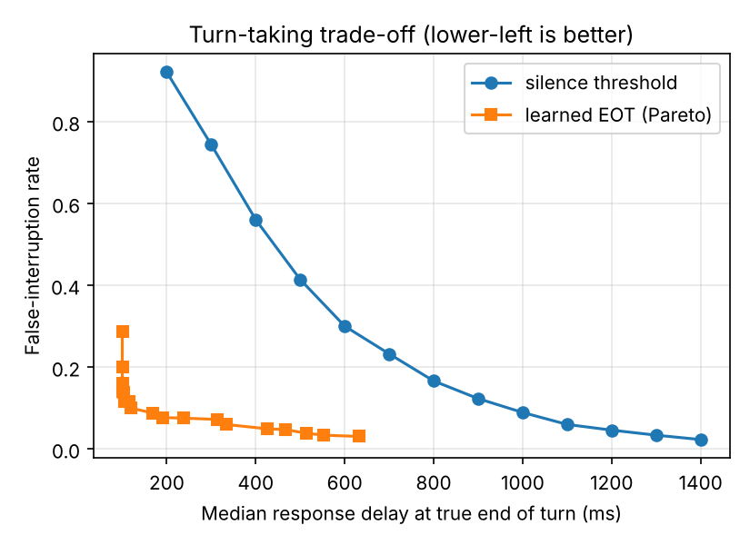

# duplex-voice-agent

A streaming voice agent (speech-to-text, LLM, text-to-speech) built around one question: where do the milliseconds go in a voice conversation, and how do you get them back? It runs on a laptop CPU. The models are hosted APIs; the work here is in the orchestration.

## What it does

Audio comes in as 20 ms frames, goes through voice activity detection, streams to STT, and an endpointer decides when the user has finished. The LLM reply is streamed to TTS clause by clause and played back at a controlled pace. If the user talks over the agent, the reply is cancelled and the conversation history is cut to what the user actually heard, so the LLM doesn't assume they heard the rest.

It works from a browser over WebSocket and over phone calls through Twilio Media Streams (8 kHz mu-law). Providers are swappable. There are adapters for Smallest.ai (Pulse STT, Lightning TTS, Electron LLM), any OpenAI-compatible LLM, and mocks with configurable latency and failures for testing.

## Results

In a load test with 100 simulated callers, deciding that the user has finished speaking was the biggest cost, at about 520 ms of a roughly 880 ms response. One process handled 600 concurrent calls with under 8 ms of event-loop lag.

Starting the LLM on the partial transcript during the user's pause cut median response time from 888 ms to 698 ms. About 12% of those early starts get thrown away when the transcript changes.

I trained a small end-of-turn model (MiniLM, int8 ONNX, about 3 ms on one CPU thread) on 500k examples built from dialogue text. At the same 500 ms median delay as a plain silence rule, it cut false interruptions from 41% to about 5% in an offline evaluation with modelled pauses. It still struggles with people reading out numbers, which look finished when they aren't.

Against Smallest.ai's real API, from a Kaggle VM: TTS first audio at about 400 ms (roughly half of it network), STT finalisation at about 97 ms, near-zero word error rate on clean speech. Audio arrives at about real-time speed, so playback needs a small buffer. Details are in BENCHMARK.md.



## Running it

```
pip install -e ".[dev]"
pytest -q
python -m loadtest.run --calls 100 --barge-in 0.3 --speculate 200
uvicorn voice.server:app --port 8000
```

The server uses mock providers by default. Set PROVIDERS=smallest and SMALLEST_API_KEY to use real ones, and ENDPOINTER=learned to use the trained turn detector. The training script for that model is turn_detector/train.py (about 15 minutes on a free Kaggle T4).

## Not done yet

Testing on real call audio, prosody features for the turn detector, slot-aware handling of spoken numbers, and rerunning the benchmark from a server closer to the providers.
